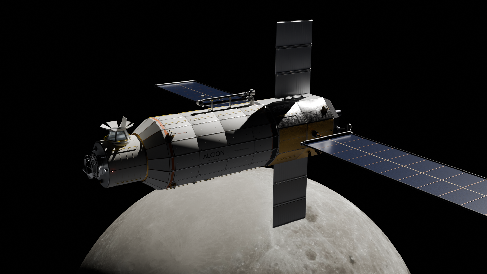

# ALCIÓN HX-4 — Vehículo tripulado cislunar de ciencia y servicio

Proyecto de ingeniería conceptual y modelado 3D de una nave espacial **original**. Incluye un modelo maestro procedural en Blender, planos generados desde el propio modelo, renders físicos y una aplicación web de inspección con vista explosionada integral.

> **Aviso.** Es un diseño conceptual de alta fidelidad, no un vehículo certificado ni planos de fabricación. El fabricante, *Varro-Lindqvist Astronautics*, es ficticio. Las cifras de rendimiento son hipótesis de orden de magnitud (ver [`docs/VALIDACION.md`](docs/VALIDACION.md)).



## Resumen

| | |
|---|---|
| Misión | Salidas de hasta 45 días desde una estación lunar (NRHO): servicio robótico de observatorios, captura de muestras y ciencia en órbita |
| Tripulación | 4 |
| Dimensiones | 19,6 m de longitud · 39,4 m de envergadura · 15,5 m de altura con radiadores |
| Presurizado | ≈ 139 m³ (nodo con cúpula + módulo habitable de 4 bahías) |
| Propulsión | 4 Hall de clase 6 kW (SEP) + 4 bipropelentes de 400–500 N + 40 propulsores RCS |
| Potencia | 2 alas enrollables de 4,4 × 16 m (≈ 48 kW al inicio de vida) |
| Modelo | **681 piezas** en **130 grupos** (5 niveles), **1.787 tornillos** por instancia, ≈ 544 k triángulos, 61 materiales PBR |

## Entregables

| Entregable | Ruta |
|---|---|
| Modelo maestro de Blender | [`blender/ALCION_HX4_master.blend`](blender/ALCION_HX4_master.blend) |
| Scripts de generación | [`blender/alcion/`](blender/alcion) (`spec`, `lib`, `materials`, `exterior`, `systems`, `interior`), [`blender/build.py`](blender/build.py) |
| Scripts de automatización | [`blender/render.py`](blender/render.py), [`blender/blueprints.py`](blender/blueprints.py), [`blender/blueprint_compose.py`](blender/blueprint_compose.py), [`blender/inventory_md.py`](blender/inventory_md.py), [`blender/make_textures.py`](blender/make_textures.py), [`renders/render_all.sh`](renders/render_all.sh) |
| GLB completo (máxima fidelidad) | [`export/alcion_hx4.glb`](export/alcion_hx4.glb) |
| GLB optimizados (web: exterior + interior diferido) | [`web/public/models/`](web/public/models) |
| Planos conceptuales (10 láminas) | [`blueprints/`](blueprints) |
| Inventario jerárquico | [`docs/INVENTARIO.md`](docs/INVENTARIO.md), [`docs/inventario.json`](docs/inventario.json), [`docs/inventario.csv`](docs/inventario.csv) |
| Documentación técnica | [`docs/INFORME_TECNICO.md`](docs/INFORME_TECNICO.md) |
| Investigación y referencias | [`docs/INVESTIGACION.md`](docs/INVESTIGACION.md) |
| Renders exteriores e interiores | [`renders/`](renders) |
| Aplicación web interactiva | [`web/`](web) |
| Informe de validación y limitaciones | [`docs/VALIDACION.md`](docs/VALIDACION.md) |

## Requisitos

- **Blender 4.2 LTS** (probado con 4.2.3). Sin MCP: todo se ejecuta por línea de órdenes con `bpy`.
- **Python 3** con `Pillow` y `numpy`, para componer los planos.
- **Node.js 20+**, para la aplicación web.

## Ejecución

```bash
# 1. Construir el modelo maestro (.blend), exportar GLB e inventario (~10 s)
blender -b --python blender/build.py

# 2. Optimizar los GLB para la web (meshopt + cuantización, conserva la jerarquía)
cd web && npm install && npm run optimize-model && cd ..

# 3. Planos: proyecciones ortográficas + composición con cotas y cajetín
blender -b blender/ALCION_HX4_master.blend --python blender/blueprints.py
python3 blender/blueprint_compose.py && cp blueprints/*.png web/public/blueprints/

# 4. Inventario en Markdown
python3 blender/inventory_md.py

# 5. Renders finales (Cycles CPU; ~5 min por vista a 1920×1080 y 96 muestras)
bash renders/render_all.sh 96
#    vista individual o explosionada:
blender -b blender/ALCION_HX4_master.blend --python blender/render.py -- \
    --mode final --views hero --res 1920x1080 --samples 128 --out renders
blender -b blender/ALCION_HX4_master.blend --python blender/render.py -- \
    --mode final --views exploded --explode 1.0 --out renders

# 6. Aplicación web
cd web
npm run dev        # desarrollo en http://localhost:5173
npm run build      # producción en web/dist (estática, se puede servir desde cualquier hosting)
npx vite preview   # servir la build
```

## Aplicación web

- **Inspector:** árbol jerárquico de 811 nodos con búsqueda, ocultación por rama, ficha de cada pieza (descripción, función, materiales, envolvente, triángulos), enfocar, aislar y subir de nivel.
- **Vista explosionada:** deslizador continuo de 0 a 100 % con etapas *Módulos → Sistemas → Conjuntos → Piezas*, animación reversible, guías de trayectoria y etiquetas.
- **Sección:** plano de corte transversal, longitudinal u horizontal con posición continua.
- **Rayos X:** transparencia de Fresnel; la selección se mantiene opaca.
- **Vistas:** isométrica, frontal, lateral, superior, inferior y posterior, con opción cuasi-ortográfica.
- **Interior:** navegación en primera persona (arrastrar y WASD/QE, con controles táctiles en móvil) con 6 puntos de visita.
- **Iluminación:** Órbita lunar (Luna LRO de fondo), Sol directo, Estudio y Técnico.
- **Presentación:** recorrido guiado por el scroll (cámara, explosión y rayos X interpolados), introducción cinematográfica y modo de pantalla completa con órbita automática.
- **Planos** con zoom y desplazamiento, y **ficha técnica** con perfil de misión, filosofía de diseño y fuentes.
- **Rendimiento:** carga progresiva (el exterior primero y el interior en segundo plano), compresión meshopt, renderizado bajo demanda, descarte de detalles por debajo de 1 px, tres niveles de calidad y diseño adaptable a móvil.

## Estructura

```
blender/            generador procedural, render, planos, texturas
  alcion/spec.py    cotas maestras: fuente única de verdad
  ALCION_HX4_master.blend
export/             GLB de máxima fidelidad
blueprints/         láminas BP-01 … BP-10
renders/            renders Cycles
docs/               informe técnico, investigación, inventario, validación
web/                aplicación React + TypeScript + three.js
```
