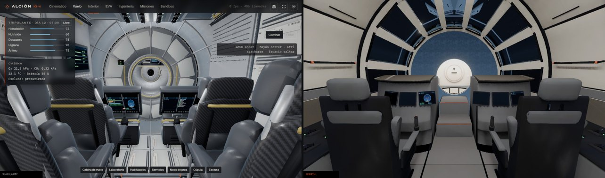
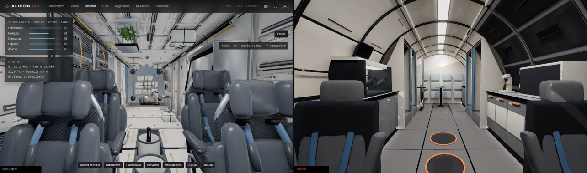
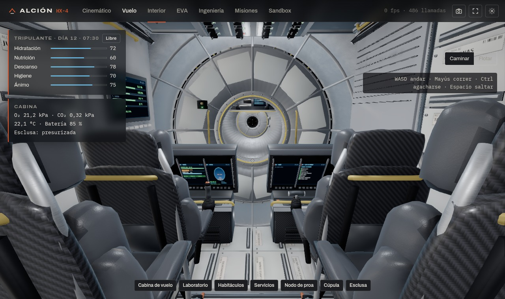
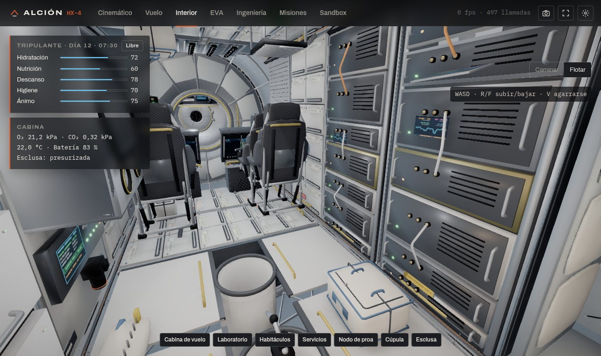
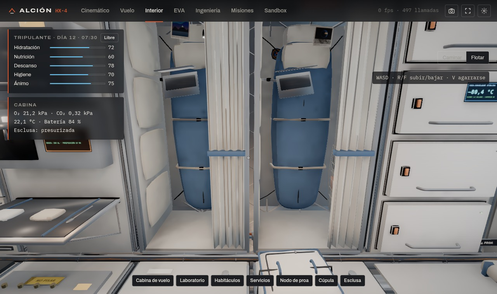
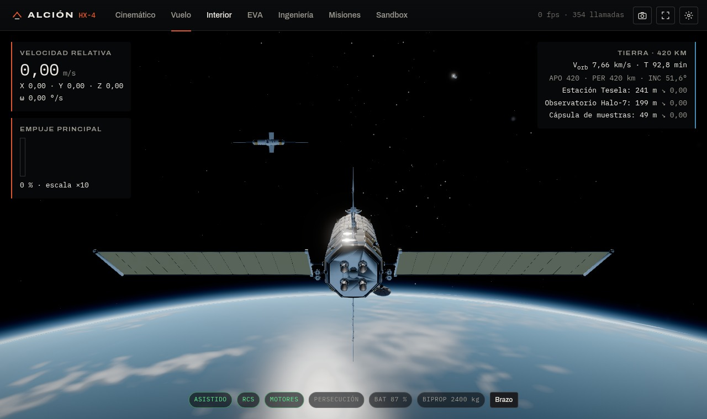
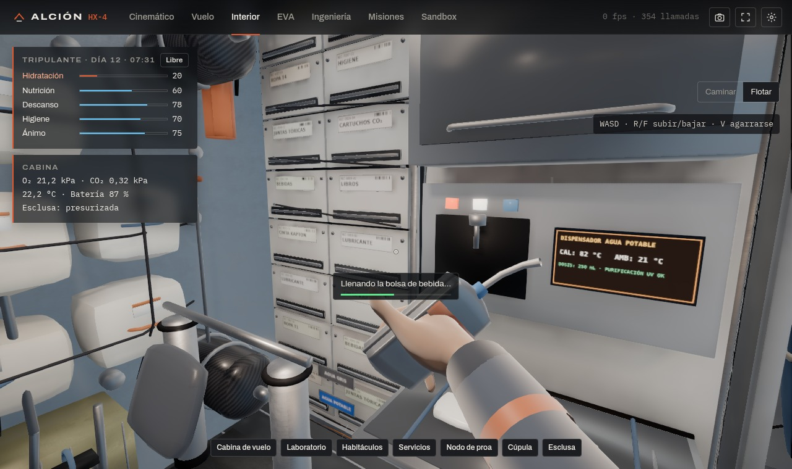
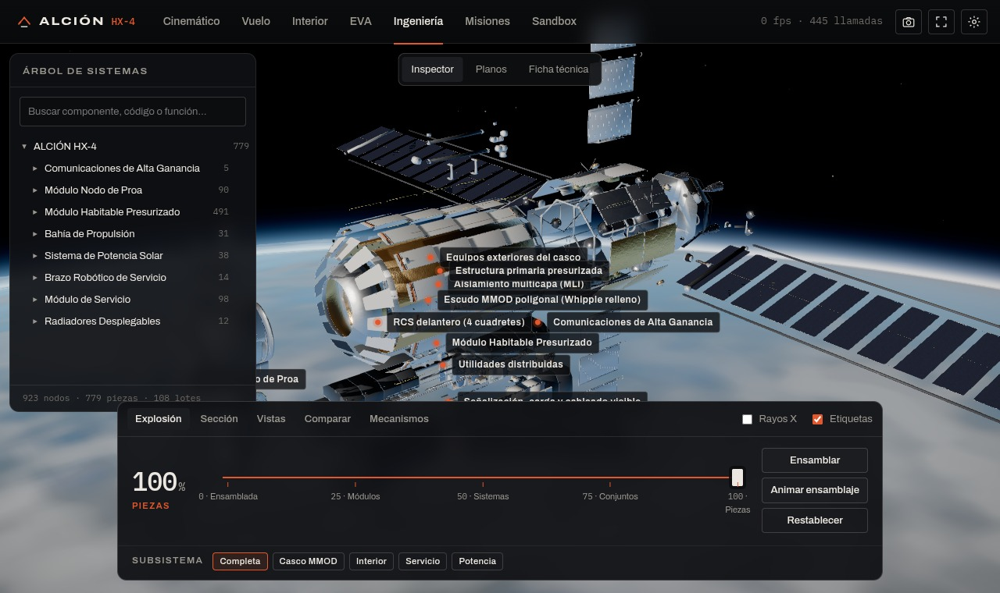
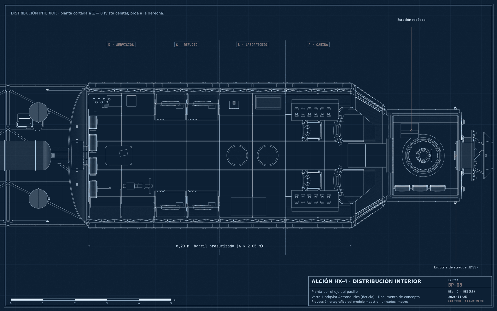
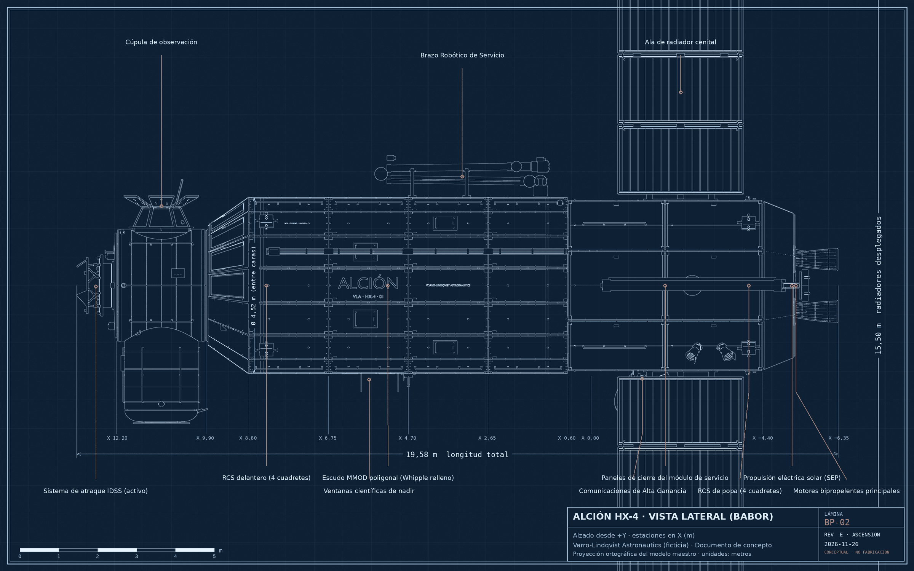

# ALCIÓN HX-4 — REBIRTH
### Nave civil conceptual explorable en tiempo real · interior, pilotaje, misiones e ingeniería

> **Aviso de alcance:** ALCIÓN HX-4 es un vehículo espacial **conceptual original** del fabricante ficticio *Varro-Lindqvist Astronautics*, para visualización, educación y simulación recreativa. **No** es un diseño calificado para vuelo ni planos de fabricación.

**Aplicación web:** https://alvarodesigns34.github.io/SHIP/ · **Estado de esta versión:** [`docs/REBIRTH_STATE.md`](docs/REBIRTH_STATE.md)

Rebirth reconstruye el producto sobre una estrategia distinta: interior inmersivo **cerrado** con iluminación horneada por estancia, **ventanas reales en la cabina**, pipeline de render propio y medible, controlador en primera persona con colisión contra la geometría real, interfaz nueva y pruebas de producto con entradas reales.

<p>
 
</p>
<sub>Izquierda de cada par: Singularity · derecha: Rebirth. Misma cámara, FOV y resolución; renderizado real de la aplicación (no Cycles).</sub>

## Resumen Técnico (Medido sobre el Modelo Maestro)

| Parámetro | Valor | Referencia |
|---|---|---|
| Misión conceptual | Hasta 45 días en órbita terrestre baja (LEO) o entorno cislunar (NRHO) · 4 tripulantes | [`docs/INGENIERIA_CONCEPTUAL.md`](docs/INGENIERIA_CONCEPTUAL.md) |
| Envolvente medida | **19,58 m** longitud · **39,42 m** envergadura · **15,50 m** altura (radiadores desplegados) | `docs/stats.json` |
| Volumen presurizado / NHV | **140,7 m³** brutos · ≈ **53,7 m³** habitables netos (≈ **13,4 m³/tripulante**) | `docs/engineering_audit.json` |
| Propulsión | 4 motores bipropelentes MMH/MON-3 (2,35 m³ → Δv ≈ 419 m/s) + 4 propulsores Hall 6 kW (1,74 m³ Xe → Δv ≈ 2,49 km/s) + 40 RCS | `blender/validate_engineering.py` |
| Potencia y térmica | 2 alas enrollables (131,9 m² celdas → ≈ 46,6 kW BOL) · radiadores doble cara (80,3 m² → 13,9–28,4 kW Stefan-Boltzmann) | `blender/validate_engineering.py` |
| Modelo maestro 3D | **779 piezas** en **144 grupos** (5 niveles), **1.855 tornillos**, **840.926 triángulos**, **64 materiales PBR** | `blender/ALCION_HX4_master.blend` |
| Motor WebGL | `BatchedMesh` (**108 lotes / 2.730 instancias**), **lightmaps GI + Contact AO horneados en Cycles (`uv1`, KTX2 UASTC)**, sondas PMREM duales, manos anatómicas riggeadas de **25 huesos** + guantes EVA, Tierra NASA 4K con dispersión Rayleigh/Mie | `web/src/engine/` |

---

## Comparativa Visual — Project Singularity (WebGL Real)

Capturas reproducibles a cámara fija (`1280×760`, calidad *Alta*) en [`docs/singularity_after/`](docs/singularity_after) frente al estado previo [`docs/singularity_baseline/`](docs/singularity_baseline):

<p>
 
 
 
</p>

---

## Entregables y Estructura

| Entregable | Ruta |
|---|---|
| Modelo maestro de Blender | [`blender/ALCION_HX4_master.blend`](blender/ALCION_HX4_master.blend) |
| Generadores 3D, Lightmaps y Manos | [`blender/alcion/`](blender/alcion) (`singularity_geo`, `spec`, `materials`, `exterior`, `systems`, `interior`, `density`, `expansion`), [`blender/bake_lightmaps.py`](blender/bake_lightmaps.py), [`blender/build_hands.py`](blender/build_hands.py) |
| Auditoría de ingeniería y sincronización | [`blender/validate_engineering.py`](blender/validate_engineering.py), [`scripts/sync_all.py`](scripts/sync_all.py) |
| Modelos Web optimizados (dual-UV + meshopt) | [`web/public/models/`](web/public/models) (`alcion_hx4_exterior.glb`, `alcion_hx4_interior.glb`, `hands_fp.glb`) |
| Lightmap Cycles KTX2 + Texturas NASA 4K | [`web/public/textures/`](web/public/textures), [`blender/textures/nasa/SOURCES.md`](blender/textures/nasa/SOURCES.md) |
| Planos conceptuales (`REV C · SINGULARITY`) | [`blueprints/`](blueprints) (`BP-01` … `BP-10`, sincronizados byte a byte con `web/public/blueprints/`) |
| Documentación y auditorías | [`docs/INGENIERIA_CONCEPTUAL.md`](docs/INGENIERIA_CONCEPTUAL.md), [`docs/SINGULARITY_AUDIT.md`](docs/SINGULARITY_AUDIT.md), [`docs/VALIDACION.md`](docs/VALIDACION.md), [`docs/INVENTARIO.md`](docs/INVENTARIO.md) |
| Aplicación web y pruebas estrictas | [`web/`](web), [`web/tests/functional.cjs`](web/tests/functional.cjs) (**22/22 PASS**), [`web/tests/compare_shots.cjs`](web/tests/compare_shots.cjs) |

---

## Ejecución y Reproducibilidad

```bash
# 1. Reconstruir modelo maestro, hornear lightmaps Cycles + KTX2 y exportar GLBs optimizados
blender -b --python blender/build.py
blender -b blender/ALCION_HX4_master.blend --python blender/bake_lightmaps.py
blender -b --python blender/build_hands.py
cd web && npm install && npm run optimize-model && cd ..

# 2. Auditoría conceptual, planos ortográficos y sincronización verificada SHA-256
blender -b blender/ALCION_HX4_master.blend --python blender/validate_engineering.py
xvfb-run -a blender -b blender/ALCION_HX4_master.blend --python blender/blueprints.py
python3 blender/blueprint_compose.py
python3 scripts/sync_all.py

# 3. Compilar, probar (22 pruebas estrictas Playwright) y publicar
cd web
npm run build
npx vite preview --port 4173 &
ALCION_URL=http://127.0.0.1:4173/ node tests/functional.cjs
bash scripts/deploy-pages.sh
```

---

## Galería de Renders Cycles y Planos

| | |
|---|---|
|  Cabina de vuelo (Bahía A) |  Laboratorio y estación nadir (Bahía B) |
|  Habitáculos y refugio (Bahía C) |  Motores C-103 y mamparo térmico de popa |
|  Cúpula hueca de 7 ventanas y contraventanas |  BP-06 Sección longitudinal (`REV C`) |
|  BP-08 Distribución interior (`REV C`) |  BP-02 Vista lateral (`REV C`) |
